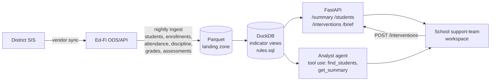

# fl-ews-engine

A working sketch of a **Florida K-8 Early Warning System (EWS) module** as it would sit behind a
district data platform: Ed-Fi-shaped data in, statute-defined indicators as plain SQL views, a
small API for school support teams, and an analyst agent that is not allowed to make up numbers.

> Concept by Sal Abuawad. Not affiliated with any vendor or school district. All student data is synthetic.

## Why Florida

Section 1001.42(18)(b), Florida Statutes, requires every school serving K-8 to run an early warning
system with four specific indicators, and requires a school-based team (with the parent) to decide
on interventions for any student who shows two or more of them. Schools must also report how many
students show each indicator, by grade. The rules are precise enough to express as code and narrow
enough that every edge case can be tested.

| Code | Indicator | Grades | How this engine evaluates it |
|------|-----------|--------|------------------------------|
| ATT  | Attendance below 90% | K-8 | All absences (excused or not) over instructional days enrolled. Integer math, so exactly 90.0% is **not** flagged. Local policy knob: no flag before 10 days enrolled. |
| SUS  | One or more suspensions | K-8 | In-school or out-of-school suspension. Detentions, conferences etc. do not count. |
| CRS  | Course failure in ELA or math | 1-8 | Letter grade `F` in an ELA or Mathematics course. Kindergarten never gets CRS. |
| LVL1 | Level 1 on FAST ELA or math, **or** a substantial reading deficiency | FAST: 3-8, SRD: K-3 | Most recent FAST result per subject. Grade 3 qualifies through either path; both paths still count as one indicator. |

Two or more indicators puts a student on the **watchlist**, which also tracks whether any
intervention is on file and how many days the student has been at 2+.

## Architecture



In this repo `ews/synth.py` stands in for the SIS and Ed-Fi layers: it writes Ed-Fi-shaped
resources (`students`, `studentSchoolAssociations`, `studentSchoolAttendanceEvents`,
`disciplineActions`, `grades`, `studentAssessments`, `studentProgramAssociations`,
`studentInterventionAssociations`, `calendarDates`, `schools`) to CSV and Parquet.

## Repo layout

```
ews/
  synth.py     seeded synthetic generator: 6 fictional schools, 770 students, Aug-Oct 2026
  rules.sql    every indicator rule as a SQL view (student_indicators, grade_counts, watchlist, ...)
  engine.py    loads Parquet into DuckDB, applies THRESHOLDS, query helpers
  api.py       FastAPI service
  agent.py     Anthropic SDK tool-use analyst + labeled offline mode
tests/         rule edge cases, API endpoints, agent (offline and a scripted tool-use loop)
```

Fictional schools: Heron Creek Elementary (HCE), Cypress Bend Elementary (CBE), Palmetto Ridge
Elementary (PRE) serve K-5; Sandhill Middle (SHM) and Gulf Pine Middle (GPM) serve 6-8;
Withlacoochee K-8 Academy (WKA) serves K-8.

## Quick start

```bash
pip install -e ".[dev]"     # or: make install
make data                   # writes data/*.csv and data/*.parquet (seed 42)
make test                   # 28 tests
make run                    # API on http://localhost:8000  (docs at /docs)
```

Docker: `docker build -t fl-ews . && docker run -p 8000:8000 fl-ews`

See [WALKTHROUGH.md](WALKTHROUGH.md) for a five-minute guided tour.

### API

| Method | Path | Purpose |
|--------|------|---------|
| GET  | `/health` | Liveness, as-of date, student count |
| GET  | `/summary?school=` | Indicator counts, 2+ count, 2+ without intervention, counts by grade (district if no school) |
| GET  | `/students?school=&grade=&min_indicators=&no_intervention=&indicator=&limit=` | Filtered student list, longest-flagged first |
| GET  | `/students/{id}` | Indicators with start dates, monthly attendance, grades, FAST, discipline, interventions |
| POST | `/interventions` | Log a team decision; the watchlist reflects it immediately |
| GET  | `/brief?school=` | Deterministic weekly support-team brief (plain text) |

### Analyst agent

```bash
python -m ews.agent "Which students at SHM have 2+ indicators and no intervention?"
```

With `ANTHROPIC_API_KEY` and `ANTHROPIC_MODEL` set, the agent runs a standard tool-use loop with two
tools (`find_students`, `get_summary`) that call the engine directly. The system prompt requires
every figure to come from a tool result and the answer to name the tool calls it used. Without a
key it runs an **offline mode**, clearly labeled in its output, that answers a few fixed question
patterns straight from the engine and says so when a question is outside them.

### Thresholds

Every threshold lives in one dict, `THRESHOLDS` in `ews/engine.py`, and is substituted into
`rules.sql` at load. Pass overrides to `Engine(thresholds={...})` to model a local policy change.

## Production notes

This is a demo. A district deployment would change the following:

- **Storage and compute.** Replace in-process DuckDB with Postgres or the district warehouse
  (Snowflake, BigQuery, Synapse). `rules.sql` is ANSI-leaning SQL and ports with small dialect
  changes. Materialize the views nightly after the Ed-Fi ingest and keep daily snapshots so trends
  and "days flagged" are auditable.
- **Identity.** SSO through the district IdP (Entra ID, Google Workspace, ClassLink) via OIDC/SAML.
  No local accounts.
- **Row-level security by school.** Staff see only students at schools where they hold a role
  (sourced from Ed-Fi `staffEducationOrganizationAssignmentAssociations`). Enforce it in the database
  (Postgres RLS policies or warehouse row access policies), not just the API.
- **FERPA audit logging.** Log every read of student-level records and every intervention write:
  who, when, which student, which endpoint, and the reason. Store logs append-only and separately
  from the data. The agent's tool calls go through the same audited path.
- **Data retention.** Set retention for raw ingest, snapshots, intervention notes and audit logs by
  the district's records schedule (Florida GS7 for public schools), purge on schedule, and keep
  nothing in LLM provider logs: use zero-data-retention terms and send only the minimum fields a
  tool result needs.
- **Agent guardrails.** Keep the tool-sourced-numbers rule, add output checks that every number in
  an answer appears in a tool result, and scope tools by the caller's row-level permissions.
- **Ops.** Data-quality checks on ingest (missing calendars, enrollment gaps, descriptor drift), CI
  running the rule tests against each threshold change, and versioned rule releases so a school
  can see which rule version produced a count.

## Shortcuts in this demo

- FAST achievement levels come from last spring's PM3 (levels are reported on PM3); a few retained
  3rd graders carry a grade-3 PM3. Real feeds would also need to handle alternate assessments.
- Substantial reading deficiency is modeled as a `studentProgramAssociations` row, which is one of
  several ways a district might record it in Ed-Fi.
- Course failure uses a progress grade of `F`; a district would map its own grading scales.
- The 10-day minimum before ATT can flag is a local policy choice, not part of the statute.
- Interventions posted through the API live in memory until the process restarts.
- No auth, RLS, or audit logging: see Production notes.

Author: Sal Abuawad.
