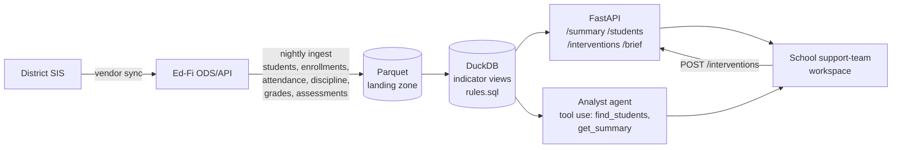

# fl-ews-engine

A working sketch of a **Florida K-8 Early Warning System (EWS) module** as it would sit behind a
district data platform: Ed-Fi-shaped data in, statute-defined indicators as plain SQL views, a
small API for school support teams, and an analyst agent instructed to cite tool results for every
number.

> Concept by Sal Abuawad. Not affiliated with any vendor or school district. All student data is synthetic.

## Why Florida

Section 1001.42(18)(b), Florida Statutes, requires every school serving K-8 to run an early warning
system with five specific indicators, and requires a school-based team (with the parent) to decide
on interventions for any student who shows two or more of them, unless the student is already
being served by an intervention program at the direction of a school-based multidisciplinary team. Schools must also report how many
students show each indicator, by grade. The rules are precise enough to express as code and narrow
enough that every edge case can be tested.

| Code | Indicator | Grades | How this engine evaluates it |
|------|-----------|--------|------------------------------|
| ATT  | Attendance below 90% | K-8 | All absences (excused or not) **plus out-of-school suspension days**, over instructional days actually enrolled (transfers counted once). Integer math, so exactly 90.0% is **not** flagged. Local policy knob: no flag before 10 days enrolled. |
| SUS  | One or more suspensions | K-8 | In-school or out-of-school suspension this school year. Detentions, conferences etc. do not count. |
| CRS  | Course failure in ELA or math | 1-8 | Letter grade `F` in an ELA or Mathematics course in any grading period this school year. Kindergarten never gets CRS. |
| LVL1 | Level 1 on the statewide ELA or math assessment | 3-8 | Most recent result per subject **that has a level** (a later PM1 row with no level never hides a Level 1). |
| DEF  | Substantial reading deficiency, or substantial mathematics deficiency | Reading: K-3, Math: K-4 | Active `studentProgramAssociations` row. A grade-3 student with a Level 1 and a reading deficiency has **two** indicators (LVL1 and DEF). |

Two or more indicators puts a student on the **watchlist**, which also tracks whether a
current-year intervention is on file and how many days the student has been at 2+.

**School-year scope.** Every indicator counts only records dated on or after `school_year_start`
(2026-07-01) and on or before `as_of_date`, from enrollments keyed to `school_year` (2027). The one
deliberate exception is LVL1: in the fall, the statewide level in effect is last spring's PM3, so
assessments are read back to `assessment_window_start` (2025-07-01, the prior school year).

**Interventions.** Only interventions that began in the current school year (between
`school_year_start` and `as_of_date`) clear the "no intervention" status. The cutoff is the
school-year start, not the date the student reached 2+, because the statute's exemption covers a
student already being served by an intervention program. `POST /interventions` rejects dates
outside that window (422).

### Statute to SQL

All views are in `ews/rules.sql`; tests are in `tests/`.

| F.S. 1001.42(18)(b) | Code | SQL view / column | Tests |
|---------------------|------|-------------------|-------|
| 1.a Attendance below 90%, excused or not, OSS counted | ATT | `enrolled_days`, `oss_days`, `attendance_daily`, `attendance_summary.att_flag` -> `indicator_events` (ATT branch) -> `student_indicators.att` | `test_rules.py::test_att_exactly_90_percent_is_not_flagged`, `test_att_min_days_is_configurable`, `test_oss_days_count_as_absences`, `test_transfer_is_one_student_with_days_enrolled_across_schools` |
| 1.b One or more suspensions, in school or out | SUS | `suspensions_current` -> `indicator_events` (SUS branch) -> `student_indicators.sus` | `test_sus_counts_iss_and_oss_but_not_other_actions`, `test_prior_year_suspension_and_failure_do_not_count` |
| 1.c Course failure in ELA or math, any grading period | CRS | `indicator_events` (CRS branch, `grades`) -> `student_indicators.crs` | `test_kindergarten_never_gets_crs`, `test_crs_grade_1_math_failure_flags`, `test_crs_ignores_non_core_subjects_and_d_grades`, `test_prior_year_suspension_and_failure_do_not_count` |
| 1.d Level 1 on statewide ELA or math | LVL1 | `indicator_events` (LVL1 branch, `studentAssessments`) -> `student_indicators.lvl1` | `test_lvl1_and_def_grade_bounds`, `test_lvl1_uses_most_recent_fast_result`, `test_later_assessment_without_level_does_not_mask_level_1`, `test_assessment_older_than_prior_year_is_ignored` |
| 1.e Reading deficiency K-3 (s. 1008.25(5)(a)) or math deficiency K-4 (s. 1008.25(6)(a)) | DEF | `indicator_events` (DEF branch, `studentProgramAssociations`) -> `student_indicators.def` | `test_grade_3_level_1_plus_reading_deficiency_is_two_indicators`, `test_math_deficiency_counts_through_grade_4_only`, `test_lvl1_and_def_grade_bounds` |
| 2. Two or more indicators -> team decision with parent, unless already served by an intervention program | 2+ | `student_indicators.indicator_count`, `grade_counts.two_plus`, `current_interventions`, `watchlist.no_intervention` | `test_two_plus_counting_and_watchlist`, `test_all_five_indicators`, `test_only_current_year_interventions_clear_the_flag`, `test_add_intervention_validates_dates_and_defaults_to_as_of`, `test_api.py::test_post_intervention_rejects_bad_dates` |
| Scope: current school year, real enrollments | all | `enrollment_spans`, `enrollment` (one row per student, `exitWithdrawDate` honored) | `test_withdrawn_student_and_prior_year_enrollment_are_out_of_scope`, `test_transfer_is_one_student_with_days_enrolled_across_schools` |

## Architecture



In this repo `ews/synth.py` stands in for the SIS and Ed-Fi layers: it writes Ed-Fi-shaped
resources (`students`, `studentSchoolAssociations`, `studentSchoolAttendanceEvents`,
`disciplineActions`, `grades`, `studentAssessments`, `studentProgramAssociations`,
`studentInterventionAssociations`, `calendarDates`, `schools`) to CSV and Parquet.

## Repo layout

```
ews/
  synth.py     seeded synthetic generator: 6 fictional schools, 770 students, Aug-Oct 2026
  rules.sql    every indicator rule as a SQL view (student_indicators, grade_counts, watchlist, ...)
  engine.py    loads Parquet into DuckDB, applies THRESHOLDS, query helpers
  api.py       FastAPI service
  agent.py     Anthropic SDK tool-use analyst + labeled offline mode
tests/         rule edge cases, API endpoints, agent (offline and a scripted tool-use loop)
```

Fictional schools: Heron Creek Elementary (HCE), Cypress Bend Elementary (CBE), Palmetto Ridge
Elementary (PRE) serve K-5; Sandhill Middle (SHM) and Gulf Pine Middle (GPM) serve 6-8;
Withlacoochee K-8 Academy (WKA) serves K-8.

## Quick start

```bash
pip install -e ".[dev]"     # or: make install
make data                   # writes data/*.csv and data/*.parquet (seed 42)
make test                   # 41 tests
make run                    # API on http://localhost:8000  (docs at /docs)
```

Docker: `docker build -t fl-ews . && docker run -p 8000:8000 fl-ews`

See [WALKTHROUGH.md](WALKTHROUGH.md) for a five-minute guided tour.

### API

| Method | Path | Purpose |
|--------|------|---------|
| GET  | `/health` | Liveness, as-of date, student count |
| GET  | `/summary?school=` | Indicator counts, 2+ count, 2+ without intervention, counts by grade (district if no school) |
| GET  | `/students?school=&grade=&min_indicators=&no_intervention=&indicator=&limit=` | Filtered student list, longest-flagged first |
| GET  | `/students/{id}` | Indicators with start dates, monthly attendance, grades, FAST, discipline, interventions |
| POST | `/interventions` | Log a team decision; the watchlist reflects it immediately |
| GET  | `/brief?school=` | Deterministic weekly support-team brief (plain text) |

### Analyst agent

```bash
python -m ews.agent "Which students at SHM have 2+ indicators and no intervention?"
```

With `ANTHROPIC_API_KEY` and `ANTHROPIC_MODEL` set, the agent runs a standard tool-use loop with two
tools (`find_students`, `get_summary`) that call the engine directly. The system prompt instructs
the model to take every figure from a tool result and name the tool calls it used; there is no
automated check of the final answer yet (see Production notes). Tools normalize school codes and
grades case-insensitively and return an explicit error (for example `unknown school code 'XYZ'`)
instead of a silent zero. Tool results carry student IDs and initials only; full names are never
sent to the model. Without a
key it runs an **offline mode**, clearly labeled in its output, that answers a few fixed question
patterns straight from the engine and says so when a question is outside them.

### Thresholds

Every threshold lives in one dict, `THRESHOLDS` in `ews/engine.py`, and is substituted into
`rules.sql` at load. Pass overrides to `Engine(thresholds={...})` to model a local policy change.

## Production notes

This is a demo. A district deployment would change the following:

- **Storage and compute.** Replace in-process DuckDB with Postgres or the district warehouse
  (Snowflake, BigQuery, Synapse). `rules.sql` is ANSI-leaning SQL and ports with small dialect
  changes. Materialize the views nightly after the Ed-Fi ingest and keep daily snapshots so trends
  and "days flagged" are auditable.
- **Identity.** SSO through the district IdP (Entra ID, Google Workspace, ClassLink) via OIDC/SAML.
  No local accounts.
- **Row-level security by school.** Staff see only students at schools where they hold a role
  (sourced from Ed-Fi `staffEducationOrganizationAssignmentAssociations`). Enforce it in the database
  (Postgres RLS policies or warehouse row access policies), not just the API.
- **FERPA audit logging.** Log every read of student-level records and every intervention write:
  who, when, which student, which endpoint, and the reason. Store logs append-only and separately
  from the data. The agent's tool calls go through the same audited path.
- **Data retention.** Set retention for raw ingest, snapshots, intervention notes and audit logs by
  the district's records schedule (Florida GS7 for public schools), purge on schedule, and keep
  nothing in LLM provider logs: use zero-data-retention terms and send only the minimum fields a
  tool result needs.
- **Agent guardrails.** Keep the tool-sourced-numbers rule, add output checks that every number in
  an answer appears in a tool result, and scope tools by the caller's row-level permissions.
- **Ops.** Data-quality checks on ingest (missing calendars, enrollment gaps, descriptor drift), CI
  running the rule tests against each threshold change, and versioned rule releases so a school
  can see which rule version produced a count.

## Shortcuts in this demo

- FAST achievement levels come from last spring's PM3 (levels are reported on PM3); a few retained
  3rd graders carry a grade-3 PM3. Real feeds would also need to handle alternate assessments.
- Substantial reading and mathematics deficiencies are modeled as `studentProgramAssociations` rows,
  which is one of several ways a district might record them in Ed-Fi.
- OSS days come from `disciplineActions.actualDisciplineActionLength` (instructional days starting on
  the discipline date, default 1). A district whose attendance feed already codes OSS days as
  absences would get the same result; days are never double-counted.
- `exitWithdrawDate` is treated as the first day no longer enrolled (exclusive).
- The statutory exemption is approximated: any intervention begun this school year counts. Ed-Fi
  `studentInterventionAssociations` has no standard field for "directed by a multidisciplinary
  team", so the engine cannot tell those apart.
- Course failure uses a progress grade of `F`; a district would map its own grading scales.
- The 10-day minimum before ATT can flag is a local policy choice, not part of the statute.
- Interventions posted through the API live in memory until the process restarts.
- No auth, RLS, or audit logging: see Production notes.

Author: Sal Abuawad.
